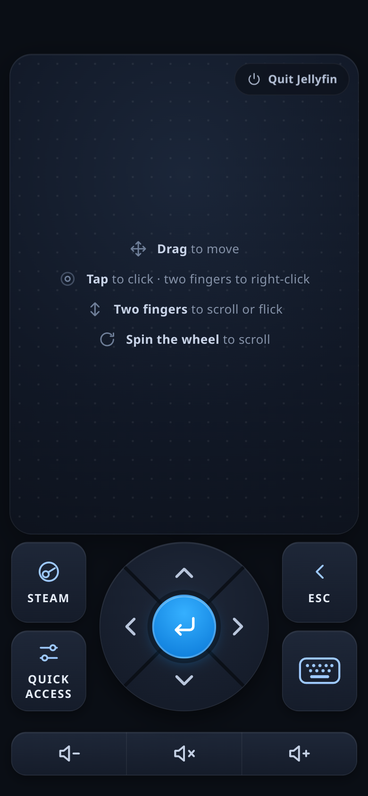
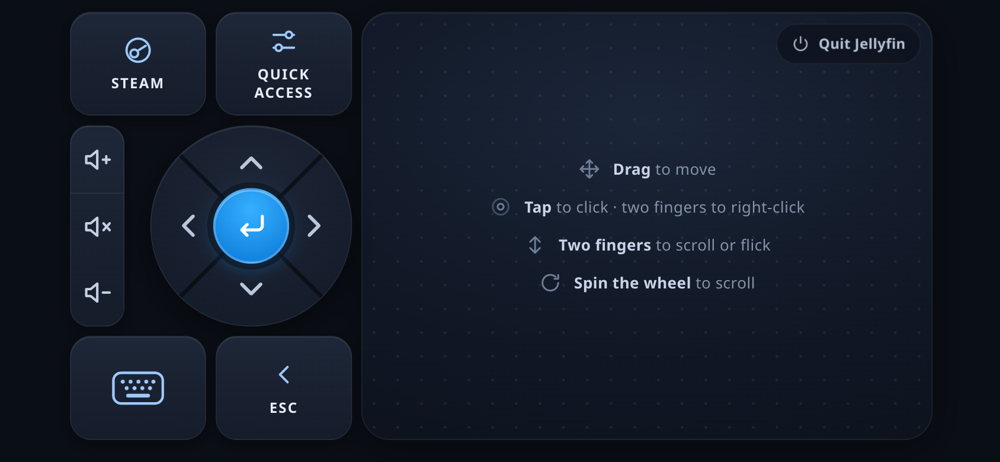

# Remote Control for Decky Loader

Use a phone or tablet as a touchpad and keyboard for your SteamOS device. Scan a QR code: **no app install** on the phone.

  
  

## What it does
- **Touchpad:** drag to move, tap to click, two-finger tap to right-click, two-finger drag to scroll (a flick keeps scrolling with momentum).
- **Navigation buttons:** an arrow wheel with Enter in the middle (hold an arrow to repeat; **spin your thumb around the wheel to scroll**), Esc, Steam menu and Quick Access (each toggles its menu).
- **Volume:** down, mute, up. Uses HDMI CEC when audio plays over HDMI to a CEC soundbar or TV, otherwise the system volume.
- **Quit app:** shows the name of the running app and needs a second tap within 3 seconds to close it. Hidden when nothing runs.
- **Typing:** the phone's own keyboard (swipe typing, autocorrect, dictation, emoji).
- **Cursor:** a translucent circle with a speed-based trail follows your touch above Steam's menus and apps, and disappears about 1.5 seconds after you stop. It stays in sync with the real pointer even if a controller or mouse moves it.
- **Layouts:** portrait, and a compact two-column layout for landscape phones (buttons on the left, trackpad on the right).
- **Idle cost is zero:** the server only runs while the toggle is on, and no overlay exists unless input is arriving.

## Persistence and links
- **Stays on:** turn the server on once and it comes back by itself after reboots, Decky restarts and plugin updates (the choice is saved). If the system is not ready yet at boot, it keeps retrying in the background. Turning it off in the panel also sticks.
- **The link does not change.** It contains a token that is generated once and kept in the plugin's settings (outside the plugin folder, so updates keep it). Only the panel's **New link** button replaces it, and then every saved link stops working. Keep the plugin's name ("Remote Control") unchanged, because the settings folder is named after it.
- **Address or name:** the preferred setup is the default, the IP link plus a **DHCP reservation** for the device in your router, so its IP address (and so the link) never changes. The panel says so under the QR code. If you can't reserve an address, **Use mDNS** switches the link to the device's network name (`http://<hostname>.local:8765/...`), which keeps working when the IP changes. The switch only appears when the device really answers to that name (the plugin asks the network), and mDNS may be slow or not work at all on some phones and networks: for example, iPhones can take several seconds to open a `.local` address from a closed home-screen app.
- **Saving it as an app:** open the link on your phone and use *Add to Home Screen*. The page has an icon and a web app manifest. iOS then opens it full screen like an app. On Android the page is plain HTTP, so Chrome offers a shortcut that opens in the browser instead of installing it (installing needs HTTPS).

## Install (Decky developer mode)
1. Get the zip: download it from the repository's Releases page, or build it with `./scripts/package.sh` (needs node and pnpm 9).
2. Decky settings → Developer → *Install plugin from ZIP* (or unzip into `~/homebrew/plugins/`), then restart Decky: `sudo systemctl restart plugin_loader`.
3. Open the Quick Access Menu → Remote Control → enable → scan the QR with the phone (same network).

## How it works
Python backend (stdlib only) serves the touch page + a WebSocket and injects input through `/dev/uinput` (a standard relative mouse + keyboard); no root is needed on SteamOS, where the logged-in user can open `/dev/uinput`. The URL contains a random token; "New link" revokes it.

## Limitations
- The drawn cursor follows the real pointer: it is resynced from the X server of whichever window has focus while you touch the phone. While Quick Access has focus it cannot be read, so it relies on counting your moves until focus returns.
- The cursor is drawn in its own Steam browser view (above menus and apps launched from Steam). That view would swallow clicks, so it is hidden for a moment while a tap happens (a brief flicker). How it looks over every individual game has not been checked.
- Characters outside ASCII are typed with `xdotool` on the display of the focused window; without `xdotool`, Ctrl+Shift+U entry is used (GTK apps only).
- Traffic is plain HTTP/WebSocket on your local network, and anyone who has the link can control the device. Use it on a trusted network, and press **New link** to revoke the current link.

## Credits and licenses
BSD 3-Clause (see `LICENSE`). Built from the [decky-plugin-template](https://github.com/SteamDeckHomebrew/decky-plugin-template). The overlay layering hook in `src/useUIComposition.tsx` is adapted from [rossimo/decky-pip](https://github.com/rossimo/decky-pip) (BSD-3-Clause). QR codes are drawn with [qrcode-generator](https://github.com/kazuhikoarase/qrcode-generator) (MIT).
